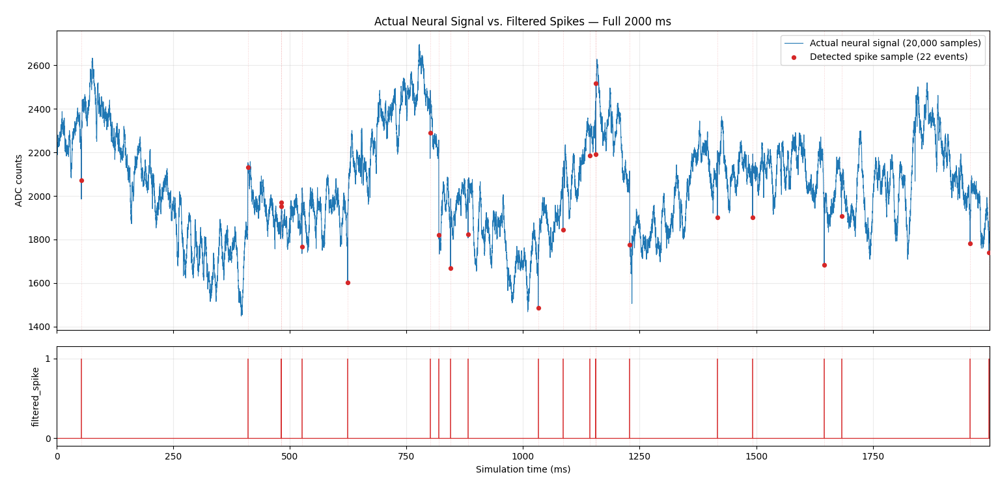

# Real-Time Neural Spike Detector ASIC

**UniChip Competition Submission — Tiny Tapeout (GF180)**

**Top-Level Module:** `tt_um_rs2387_project`

## Overview & Specification

This project implements a real-time digital neural spike-detection ASIC designed to fit within a $1 \times 1$ **tile area** on a **Tiny Tapeout GF180** chip.

Instead of streaming every recorded neural data point to a central processor, the chip processes incoming extracellular signals locally in hardware and outputs a single-cycle digital event flag whenever a potential neural spike occurs.

### Key Advantages

* **Ultra-Low Latency:** Dedicated hardware detects spikes in microseconds as samples arrive, without waiting for a central processor.

* **Energy Efficiency:** Transmitting sparse binary spike events rather than continuous multi-bit waveforms dramatically reduces data bandwidth and overall system power consumption.

* **High Scalability:** Multiple ASIC tiles can process signals from separate electrodes in parallel, avoiding communication bottlenecks in multi-channel recording arrays.

## Applications

In closed-loop neurotechnology, flagging an electrical spike with near-zero delay enables immediate system response while leaving spike interpretation to electrode placement and system calibration:

* **Medical Devices:** Real-time detection of epileptic seizures or brain–spinal cord signals to trigger rapid therapeutic stimulation.

* **Brain-Computer Interfaces (BCIs):** Translating neural firing activity into control commands instantaneously without lag, overheating, or high power draw.

## Hardware Architecture

### Signal Processing Pipeline

```
  uio_in[6:0], ui_in[7:0] ──> sample[14:0] ──┬──────────────────────────────────┐
  uio_in[7] ────────────────> sample_valid    │                                ▼
                                             ├──> [ exponential_moving_average ]
                                             │                  │
                                             │               ema[14:0], ema_valid
                                             │                  ▼
                                             └──> [       spike_detector       ]
                                                                │
                                                            raw_spike
                                                                │
                                                                ▼
                                                      [ Rising-Edge Filter ]
                                                                │
                                                                ▼
                                                      uo_out[0] (filtered_spike)

```

### Tiny Tapeout Pinout

| Signal | Direction | Width | Description | 
| ----- | ----- | ----- | ----- | 
| `clk` | Input | 1 | System clock | 
| `rst_n` | Input | 1 | Active-low reset | 
| `ena` | Input | 1 | Design enable signal | 
| `ui_in[7:0]` | Input | 8 | Lower 8 bits of the 15-bit neural sample (`sample[7:0]`) | 
| `uio_in[6:0]` | Input | 7 | Upper 7 bits of the 15-bit neural sample (`sample[14:8]`) | 
| `uio_in[7]` | Input | 1 | Sample valid strobe (`sample_valid`) | 
| `uo_out[0]` | Output | 1 | Single-cycle filtered spike detection flag (`filtered_spike`) | 
| `uo_out[7:1]` | Output | 7 | Unused outputs (tied low: `7'b0000000`) | 
| `uio_out[7:0]` | Output | 8 | Unused bidirectional outputs (tied low) | 
| `uio_oe[7:0]` | Output | 8 | Bidirectional output enable (configured as inputs) | 

## RTL Module Descriptions

### 1. `exponential_moving_average.v` (Sequential Logic)

Tracks the slow-varying baseline of the neural recording using a multiplier-free exponential moving average (EMA) filter with smoothing factor $\alpha = \frac{1}{16}$.

* **Inputs:** `clk`, `rst_n`, `ena`, `sample[14:0]`

* **Outputs:** `ema[14:0]`, `valid`

* **Internal State:**

  * `ema_acc` — Fixed-point accumulator scaled by $16\times$ (storing 4 fractional LSBs so right-shifts preserve decimal precision)

  * `initialised` — 1-bit status flag tracking whether the first sample has been latched

#### Operation per Clock Cycle

1. **Reset (`!rst_n`):** Resets `ema_acc` and `initialised` to `0`.

2. **Initialization (`ena && !initialised`):** Sets `initialised <= 1` and seeds `ema_acc` with `sample` shifted left by 4 bits (appending 4 trailing zeros, i.e., $16 \times \text{sample}$) so the initial baseline matches the first incoming sample.

3. **Steady-State Filtering (`ena && initialised`):** Evaluates:

   $$
   \text{EMA}_{\text{new}} = \text{EMA} - \frac{\text{EMA}}{16} + \frac{\text{sample}}{16}
   $$

   Because `ema_acc` stores $16 \times \text{EMA}$, multiplying both sides by $16$ yields a shift-and-add update:

   ```
   ema_acc <= ema_acc - (ema_acc >> 4) + {4'd0, sample};
   
   ```

4. **Output Extraction:** Slices out the integer bits (dropping the 4 fractional LSBs) for the 15-bit baseline output:

   ```
   assign ema = ema_acc[18:4];
   
   ```

### 2. `spike_detector.v` (Combinational Logic)

Detects rapid voltage excursions relative to the dynamic EMA baseline.

* **Inputs:** `ema[14:0]`, `sample[14:0]`

* **Outputs:** `spike` (unfiltered `raw_spike`)

* **Operation:** Combinationally computes the absolute difference $\vert{}\text{sample} - \text{ema}\vert{}$ and asserts `spike = 1` whenever the deviation exceeds the configured detection threshold.

### 3. `tt_um_rs2387_project.v` (Top-Level Integration)

Integrates `exponential_moving_average` and `spike_detector` into the Tiny Tapeout wrapper and conditions the detection output into a single-cycle pulse.

* **Input Assembly:** Concatenates `{uio_in[6:0], ui_in}` into the 15-bit `sample` bus and uses `uio_in[7]` as `sample_valid`.

* **Positive-Edge Pulse Conditioning:** Registers `raw_spike` into `previous_raw_spike` on every clock cycle so that `filtered_spike` asserts for exactly one clock cycle on the `0 -> 1` rising edge of a valid detection:

  ```
  assign filtered_spike = !previous_raw_spike && raw_spike && ena && sample_valid && ema_valid;
  assign uo_out = {7'b0000000, filtered_spike};
  
  ```

## Repository Structure

```
tt-neural-spiking-detection/
├── src/
│   ├── tt_um_rs2387_project.v                            # Tiny Tapeout top-level module & rising-edge filter
│   ├── exponential_moving_average.v                      # Sequential 16x-scaled EMA baseline filter
│   ├── spike_detector.v                                  # Combinational absolute-difference threshold detector
│   └── config.json                                       # OpenLane / Tiny Tapeout hardening configuration
├── test/
│   ├── tt_um_rs2387_project_tb.v                         # Verilog testbench feeding sample.txt vectors
│   ├── tb.v                                              # Tiny Tapeout cocotb wrapper testbench
│   ├── test.py                                           # Tiny Tapeout automated verification script
│   └── Makefile                                          # Local simulation build rules
├── scripts/
│   ├── plot_hc1_data.py                                  # Loads & visualizes CRCNS hc-1 extracellular recordings
│   ├── get_samples.py                                    # Exports 1 s (10,000 samples @ 10 kHz) to sample.txt
│   ├── vcd_plotter.py                                    # Parses .vcd waveform & compares RTL vs. Python model
│   └── sample.txt                                        # Quantized neural recording stimulus (1 sample/line)
├── docs/
│   ├── info.md                                           # Tiny Tapeout datasheet documentation
│   ├── one_ema_150thres_20000point_2.png                 # Simple EMA (threshold = 150) waveform plot
│   └── spike_signal_20000point_dynamic_thres_double_ema.png # Double EMA (dynamic threshold) waveform plot
├── info.yaml                                             # Tiny Tapeout project & pinout metadata
└── README.md

```

## Dataset & Verification Workflow

### Neural Dataset (`CRCNS hc-1`)

Hardware behavior is verified using real *in-vivo* extracellular neural recordings from the **Collaborative Research in Computational Neuroscience (CRCNS)** repository ([crcns.org](https://crcns.org/), dataset **`hc-1`**, channel 2).

* **Sampling Rate:** $10\text{ kHz}$

* **Recording Format:** Signed 16-bit recordings converted via `get_samples.py` into `sample.txt` ($10{,}000$ samples for $1\text{ s}$ of neural activity, one sample per line).

### 1. Generate Stimulus Samples

1. Run `plot_hc1_data.py` to inspect the raw `CRCNS hc-1` channel 2 waveform.

2. Run `get_samples.py` to export the quantized sample sequence to `sample.txt`.

### 2. RTL Simulation

* **Small Datasets ($\le 100$ data points):** Can be simulated directly inside **Vulkos** (or any local Verilog simulator) using `tt_um_rs2387_project_tb.v`.

* **Large Datasets ($> 100$ data points, e.g., full $10{,}000$- or $20{,}000$-sample recordings):** Use **Google Colab** with **Icarus Verilog (`iverilog`)** to generate the `.vcd` waveform file quickly without browser simulation limits:

  1. Open [Google Colab](https://colab.research.google.com/) and create a new notebook.

  2. In the left sidebar **Files** panel, open the `/content` folder and upload all design Verilog files, the testbench file, and the sample stimulus file:

     * `spike_detector.v`

     * `exponential_moving_average.v`

     * `tt_um_rs2387_project.v`

     * `tt_um_rs2387_project_tb.v`

     * `sample.txt`

  3. Run the following commands in a Colab code cell to install Icarus Verilog, compile the RTL and testbench, and execute the simulation:

     ```
     !apt-get update -qq && apt-get install -y -qq iverilog
     !iverilog -o sim.vvp spike_detector.v exponential_moving_average.v tt_um_rs2387_project.v tt_um_rs2387_project_tb.v
     !vvp sim.vvp
     
     ```

  4. Once execution finishes, refresh the `/content` directory in Colab and download the generated `.vcd` waveform file (e.g., `tt_um_rs2387_project_tb.vcd`).

### 3. Plot & Compare Hardware vs. Python Model

Run `vcd_plotter.py` locally with the downloaded `.vcd` file and `sample.txt` to execute the reference Python EMA + threshold spike detector and overlay the hardware `filtered_spike` pulses onto the neural waveform for cycle-accurate verification.

## Simulation Results

Both spike-detection algorithms were evaluated across **$20{,}000$ data points** ($2000\text{ ms}$ of neural recording at a $10\text{ kHz}$ sampling rate). In each figure below, the top panel marks detected spikes (red dots) directly on the neural signal, and the bottom panel plots the corresponding single-cycle `filtered_spike` output pulses.

| Algorithm Variant | Baseline Filter | Thresholding Method | Data Points | Detected Spikes |
| :--- | :--- | :--- | :---: | :---: |
| **Simple EMA** | Single EMA ($\alpha = \frac{1}{16}$) | Fixed Threshold ($150$) | $20{,}000$ | $21$ events |
| **Double EMA** | Double EMA | Dynamic Threshold | $20{,}000$ | $22$ events |

### 1. Simple EMA Algorithm (Threshold = $150$)

Using a single exponential moving average baseline filter with a fixed threshold of $150$, the detector flags **$21$ spike events** across the $20{,}000$-sample recording:


### 2. Double EMA Algorithm (Dynamic Threshold)

Using a double exponential moving average algorithm with dynamic thresholding to adapt to local baseline shifts, the detector flags **$22$ spike events** across the same $20{,}000$-sample recording:


